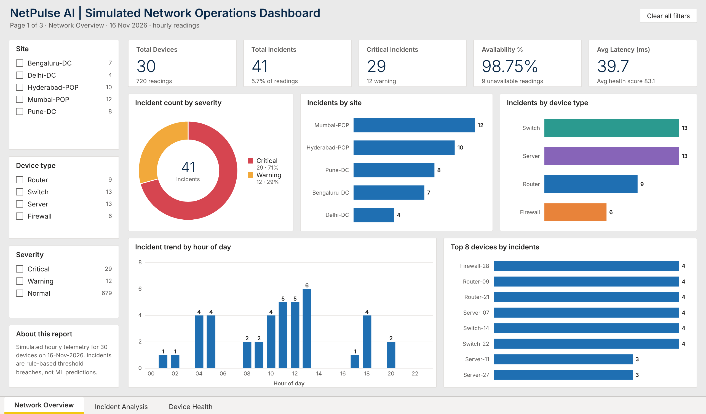
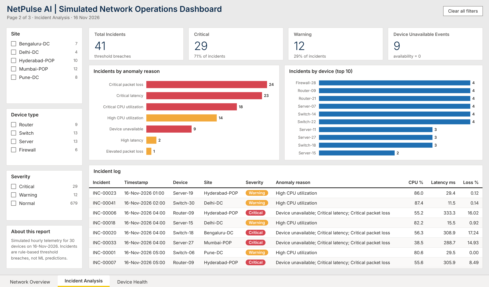
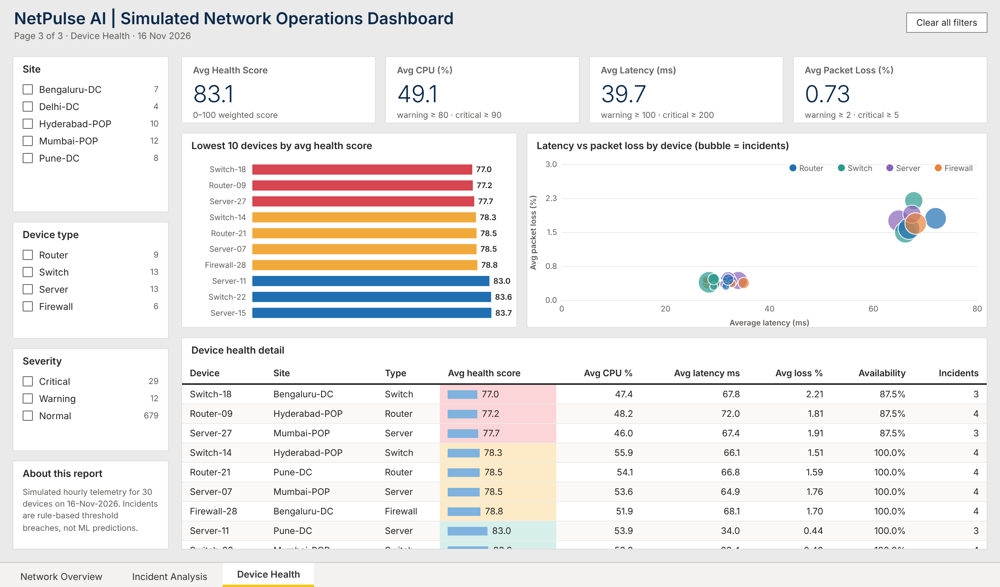

# NetPulse AI - Power BI Dashboard

Dashboard layer of the NetPulse AI project: 3 pages built on the processed CSV outputs of the Python pipeline.

| Page | Purpose |
|---|---|
| Network Overview | KPIs, severity split, incidents by site / device type / hour, top devices |
| Incident Analysis | Anomaly reasons, incidents by device, full incident log |
| Device Health | Health score ranking, latency vs packet loss, device detail table |

## Preview





Cross-filtering example (Mumbai-POP + Critical selected): [`images/04_filtered_mumbai_critical.png`](images/04_filtered_mumbai_critical.png)

> The images above are previews of the report layout rendered from the real processed data (`data/`). They are not exported from Power BI Desktop. The interactive HTML preview behaves like the report: click slicers or chart elements to cross-filter.

## Folder contents

```text
PowerBI_Dashboard/
├── images/                 dashboard previews (PNG, 2560x1504)
├── interactive_preview/    NetPulse_Dashboard_Preview.html (open in any browser)
├── data/                   CSVs to import (fact, incidents, device summary, dimensions)
├── dax/measures.dax        all DAX measures
├── theme/NetPulse_Theme.json   Power BI theme (View > Themes > Browse)
├── docs/BUILD_GUIDE.md     step-by-step build of the .pbix
├── build_preview.py        regenerates the HTML preview from data/
└── dashboard_template.html
```

## Key findings (simulated data, 16 Nov 2026)

- 720 hourly readings across 30 devices; **41 incidents (5.7%)**, of which 29 Critical and 12 Warning.
- Network availability **98.75%**; 9 unavailable readings.
- **Mumbai-POP** has the most incidents (12), then Hyderabad-POP (10); Delhi-DC has the fewest (4).
- Switches and Servers each account for 13 incidents; Firewalls for 6.
- Incidents cluster between **10:00 and 13:00** (20 of 41) and again at **04:00-05:00** (8).
- Main triggers: Critical packet loss (24), Critical latency (23), Critical CPU (18).
- Lowest average health: Switch-18 (77.0), Router-09 (77.2), Server-27 (77.7).
- Data is simulated and rules are thresholds, not ML.

## Rebuild

```bash
python run_pipeline.py                      # regenerate processed CSVs
python PowerBI_Dashboard/build_preview.py   # regenerate HTML preview
```
Then follow `docs/BUILD_GUIDE.md` to build the `.pbix`.
