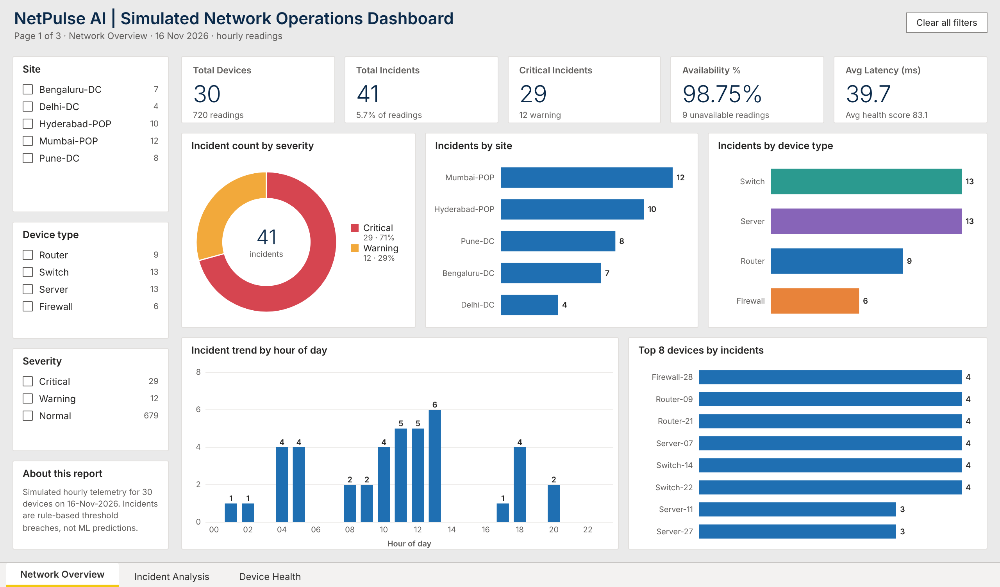

# NetPulse AI — Network Monitoring & Incident Detection System

A Python + SQL + Power BI portfolio project that analyzes network-device telemetry, flags threshold-based anomalies, classifies incidents, and produces dashboard-ready CSV outputs.

> **Data notice:** This repository uses deterministic, simulated network telemetry. It does not connect to real routers, switches, firewalls, SNMP, or a live production network. Incident labels are rule-based indicators, not machine-learning predictions or confirmed root-cause diagnoses.

## Business problem

Network operations teams need a consistent way to review device availability and performance signals. High CPU utilization, latency, packet loss, or device unavailability can indicate a condition that deserves investigation. NetPulse AI demonstrates a repeatable workflow for turning telemetry records into prioritized incident data.

## What it does

1. Loads device inventory and hourly telemetry from CSV.
2. Validates required fields, converts data types, and removes duplicate device/timestamp readings.
3. Joins telemetry to device inventory.
4. Applies transparent threshold rules to classify readings as `Normal`, `Warning`, or `Critical`.
5. Creates a weighted health score (0–100) for portfolio analysis.
6. Exports detailed analysis, incident records, and device-level summaries for Power BI.
7. Includes MySQL schema and example operational analysis queries.

## Technology

- Python, Pandas, NumPy
- MySQL (schema, constraints, indexes, analysis queries)
- Power BI (dashboard built by importing processed CSV files)

## Repository structure

```text
NetPulse_AI/
├── data/
│   ├── raw/
│   │   ├── devices.csv
│   │   └── network_telemetry.csv
│   └── processed/
│       ├── network_analysis.csv
│       ├── incidents.csv
│       └── device_summary.csv
├── docs/
│   └── power_bi_dashboard_guide.md
├── sql/
│   ├── schema.sql
│   └── analysis_queries.sql
├── src/
│   └── analyzer.py
├── run_pipeline.py
├── requirements.txt
└── README.md
```

## Run locally

Python 3.10+ is recommended.

```bash
# 1. Create and activate a virtual environment (optional but recommended)
python -m venv .venv

# Windows PowerShell
.venv\Scripts\Activate.ps1

# macOS/Linux
source .venv/bin/activate

# 2. Install dependencies
pip install -r requirements.txt

# 3. Run the pipeline
python run_pipeline.py
```

The generated files are written to `data/processed/`.

## Rule thresholds

| Metric | Warning | Critical |
|---|---:|---:|
| CPU utilization | >= 80% | >= 90% |
| Latency | >= 100 ms | >= 200 ms |
| Packet loss | >= 2% | >= 5% |
| Availability | — | 0 (unavailable) |

A reading is marked Critical if any critical threshold is met; otherwise, it is Warning when at least one warning threshold is met. These are configurable demonstration thresholds, not universal network standards.

## Health score

The demo health score combines CPU utilization, latency, packet loss, and availability into a 0–100 score. It is an illustrative prioritization metric, not an industry-standard SLA or service-health score. Review `src/analyzer.py` before adapting the weights for a real environment.

## MySQL

1. Open MySQL Workbench.
2. Run `sql/schema.sql` to create the database and tables.
3. Import `data/raw/devices.csv` into `devices`.
4. Import the processed telemetry fields from `data/processed/network_analysis.csv` into `telemetry`, mapping:
   - `timestamp` → `recorded_at`
   - `device_id` → `device_id`
   - CPU, latency, packet loss, availability, severity, anomaly reason, health score → matching columns.
5. Run queries from `sql/analysis_queries.sql`.

For a production implementation, use a controlled ETL/load script rather than manual CSV import.

## Power BI dashboard

Dashboard preview, DAX measures, theme and build guide are in [`PowerBI_Dashboard/`](PowerBI_Dashboard/README.md).



Follow the instructions in [`docs/power_bi_dashboard_guide.md`](docs/power_bi_dashboard_guide.md). Import:
- `data/processed/network_analysis.csv`
- `data/processed/incidents.csv`
- `data/processed/device_summary.csv`

Suggested report pages:
- Network Overview: device count, incident count, severity split, availability, average latency.
- Incident Analysis: severity by site/device, incident reasons, hourly trend.
- Device Health: health score, CPU, latency, packet loss, availability by device.

## Limitations and next steps

- Synthetic data only; no live monitoring agent or network polling is included.
- Rule-based thresholds can generate false positives and need tuning to network baselines.
- The root-cause field is a suggested investigation action, not a definitive diagnosis.
- Next steps: integrate authorized SNMP/API telemetry, add scheduled ingestion, alert routing, SLA-aware thresholds, and monitoring-history retention.

## Resume note

Only list this project as completed after you have run the pipeline, reviewed the output, and built the dashboard you claim. Describe it as a **simulated network telemetry analysis project**. Do not claim live network monitoring or predictive AI.
